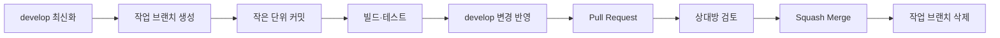

# AI 건강습관 MVP GitHub 브랜치 전략

작성일: 2026-10-13  
개발 기간: 8주  
개발 인원: 성준, 현서  
적용 방식: 경량 Git Flow + GitHub Pull Request

## 1. 목적

이 문서는 성준과 현서가 백엔드와 Android 앱을 동시에 개발할 때 코드 충돌과 불안정한 병합을 줄이기 위한 GitHub 운영 규칙을 정의한다.

프로젝트 규모가 2명·8주이므로 복잡한 Git Flow 전체를 적용하지 않는다. `main`, `develop`, 짧은 기능 브랜치를 중심으로 운영하고 시연 가능한 버전을 지속적으로 유지한다.

## 2. 핵심 원칙

1. `main`과 `develop`에 직접 커밋하지 않는다.
2. 모든 변경은 목적이 명확한 작업 브랜치에서 진행한다.
3. 작업 브랜치는 가능하면 1~3일 안에 병합한다.
4. Pull Request와 자동 빌드·테스트를 통과한 뒤 병합한다.
5. 기능 PR은 Squash Merge를 사용한다.
6. API 계약과 DB 변경은 구현 전에 공유한다.
7. AI가 생성한 코드는 빌드와 테스트 없이 병합하지 않는다.
8. 매주 시연 가능한 안정 버전을 `main`에 남긴다.

## 3. 브랜치 구조

```text
main                         시연·배포 가능한 안정 버전
├─ develop                   기능 통합 및 공동 테스트
│  ├─ feat/backend/*         Spring Boot 기능
│  ├─ feat/android/*         Android 기능
│  ├─ fix/*                  일반 오류 수정
│  ├─ docs/*                 문서와 API 계약
│  ├─ test/*                 테스트 보강
│  └─ chore/*                설정·CI·빌드 작업
├─ release/*                 최종 안정화가 필요한 릴리스
└─ hotfix/*                  main의 긴급 오류 수정
```

### main

- 항상 빌드·실행·시연 가능한 상태를 유지한다.
- 직접 Push를 금지한다.
- `develop`, `release/*`, `hotfix/*` PR만 병합한다.
- 병합 후 의미 있는 버전 태그를 생성한다.
- Force Push와 브랜치 삭제를 금지한다.

### develop

- 성준과 현서의 기능을 합치는 통합 브랜치다.
- 개발 서버 및 통합 테스트의 기준으로 사용한다.
- 직접 Push를 금지한다.
- 기능·수정·문서 브랜치는 `develop`에서 생성하고 `develop`으로 PR을 보낸다.

### 기능 브랜치

- 하나의 기능 또는 하나의 명확한 변경만 포함한다.
- 개인 이름이 아니라 작업 목적을 브랜치명에 표시한다.
- 병합 후 원격 브랜치를 삭제한다.

좋은 예:

```text
feat/backend/drug-search-api
feat/backend/meal-record-api
feat/backend/medication-schedule
feat/android/drug-search-screen
feat/android/meal-record-screen
feat/android/medication-screen
fix/backend/duplicate-intake
fix/android/login-loading
docs/api-medication
chore/backend-ci
```

피해야 할 예:

```text
seongjun
hyeonseo
test
work
final
new-feature
```

개인 이름 브랜치는 작업 목적을 알 수 없고 장기간 유지되기 쉬우므로 사용하지 않는다.

## 4. 브랜치 이름 규칙

새 작업 브랜치는 생성 주체와 관계없이 아래 유형·영역 규칙을 동일하게 적용하고 PR 대상은 `develop`으로 한다.
사용자 요청에 따라 `codex/` 접두어는 붙이지 않는다.
예: `feat/backend/meal-record-api`, `fix/backend/drug-search`, `docs/branch-strategy`.
기존 브랜치명과 커밋 이력은 별도 요청 없이 변경하지 않는다.

```text
<유형>/<영역>/<짧은-작업명>
```

### 유형

| 유형 | 사용 목적 | 예시 |
|---|---|---|
| `feat` | 새로운 기능 | `feat/backend/drug-search-api` |
| `fix` | 일반 오류 수정 | `fix/android/meal-photo-error` |
| `hotfix` | main 긴급 수정 | `hotfix/login-crash` |
| `docs` | 문서·API 계약 | `docs/api-meal-record` |
| `test` | 테스트 추가·수정 | `test/backend/medication-service` |
| `refactor` | 동작 변경 없는 구조 개선 | `refactor/android/network-client` |
| `chore` | 빌드·설정·CI | `chore/backend-github-actions` |
| `release` | 배포 전 안정화 | `release/v0.5.0` |

### 영역

- `backend`: Spring Boot와 MariaDB
- `android`: Kotlin과 Jetpack Compose
- `api`: 공통 API 계약
- 영역 구분이 불필요한 경우 생략 가능

## 5. 담당자별 브랜치 사용

### 성준

```text
develop
├─ feat/backend/auth-api
├─ feat/backend/drug-search-api
├─ feat/backend/meal-record-api
└─ feat/backend/medication-reminder
```

주요 작업:

- Spring Boot REST API
- MariaDB 스키마와 마이그레이션
- 인증·권한
- 습관·식사·복약 업무 규칙
- 알림 스케줄링
- OpenAPI 명세
- 백엔드 테스트와 배포

### 현서

```text
develop
├─ feat/android/login-screen
├─ feat/android/drug-search-screen
├─ feat/android/meal-record-screen
└─ feat/android/medication-screen
```

주요 작업:

- Jetpack Compose 화면
- ViewModel과 UI 상태
- Mock Repository
- 실제 API 연동
- 로딩·빈 결과·오류 처리
- 에뮬레이터·실제 단말 테스트

같은 사용자 기능이라도 백엔드와 Android 브랜치를 분리한다.

```text
feat/backend/drug-search-api
feat/android/drug-search-screen
```

## 6. 표준 작업 흐름



### 작업 시작

```bash
git switch develop
git pull origin develop
git switch -c feat/backend/drug-search-api
```

### 작업 중

- 기능을 작게 나누어 커밋한다.
- 빌드되지 않는 상태를 원격에 장기간 방치하지 않는다.
- 공통 파일을 변경할 때는 상대방에게 알린다.
- API 또는 DB 계약 변경은 코드보다 문서를 먼저 수정한다.

### PR 생성 전

```bash
git fetch origin
git rebase origin/develop
```

Rebase 중 충돌이 발생하면 파일을 직접 검토하고 해결한 뒤 다시 빌드·테스트한다. 이미 여러 사람이 사용하는 공유 브랜치에는 Force Push하지 않는다.

## 7. 기능 개발 순서

의약품 사전 기능 예시:

```text
1. docs/api-drug-search
   API 계약 작성

2. feat/backend/drug-search-api
   실제 검색 API 구현

3. feat/android/drug-search-screen
   Mock 기반 검색·상세 화면 구현

4. feat/android/drug-search-integration
   실제 API 연동

5. develop
   통합 테스트

6. main
   시연 안정화 후 병합과 태그 생성
```

API 계약이 확정되기 전에는 프론트엔드와 백엔드가 각자 필드명이나 상태값을 임의로 만들지 않는다.

## 8. 커밋 메시지 규칙

빈 저장소의 최초 초기화는 `chore(repo): 저장소 기본 구조와 Git 제외 규칙 설정` 기준 커밋으로 main과 develop을 만든다.
이후 설계·구현·CI 커밋은 작업 브랜치에 작성하고 develop PR로 올린다. 초기화 이후에는 main/develop 직접 Push 금지 규칙을 적용한다.

형식:

```text
<type>(<scope>): <변경 내용>
```

예시:

```text
feat(backend): 의약품 사전 검색 API 구현
feat(android): 의약품 검색 결과 화면 추가
fix(medication): 복약 기록 중복 생성 방지
docs(api): 식사 등록 API 계약 추가
test(habit): 습관 완료 상태 전환 테스트 추가
chore(ci): 백엔드 테스트 워크플로 추가
```

규칙:

- 한 커밋에는 하나의 논리적인 변경만 넣는다.
- `수정`, `작업`, `완료`처럼 의미가 불명확한 메시지는 사용하지 않는다.
- 비밀정보와 실제 사용자 데이터를 커밋하지 않는다.
- 생성 파일과 임시 파일은 `.gitignore`로 제외한다.

## 9. Pull Request 규칙

### PR 제목

```text
[BE] 의약품 이름 검색 API 구현
[APP] 의약품 사전 검색 화면 구현
[FIX] 복약 기록 중복 생성 방지
[DOCS] 식사 등록 API 계약 추가
```

### PR 크기

- 가능한 한 한 가지 기능만 포함한다.
- 검토하기 어려운 대규모 PR을 피한다.
- 기능과 무관한 자동 포맷 변경을 함께 넣지 않는다.
- DB 변경, API 변경, 화면 변경의 영향을 명확히 적는다.

### PR 본문 템플릿

```markdown
## 작업 내용

- 구현 또는 변경한 내용을 적습니다.

## 연결된 화면·API

- GET /api/v1/drugs
- 의약품 사전 검색 화면

## 테스트

- [ ] 정상 시나리오
- [ ] 입력값 오류
- [ ] 데이터 없음
- [ ] 네트워크 또는 서버 오류
- [ ] 빌드 성공

## 영향 범위

- DB 변경 여부
- API 계약 변경 여부
- 다른 기능에 미치는 영향

## 확인이 필요한 사항

- 검토자가 중점적으로 확인할 내용을 적습니다.
```

### 검토 규칙

- 최소 1명의 승인을 받는다.
- 작성자는 자기 PR을 최종 승인하지 않는다.
- 상대방이 해당 기술을 완전히 이해하기 어렵더라도 빌드 결과, API 계약, 시연 절차는 확인한다.
- 수정 요청이 반영되면 관련 부분을 다시 확인한다.

## 10. 병합 규칙

### 기능·수정 PR

- `Squash Merge` 사용
- 여러 임시 커밋을 하나의 의미 있는 커밋으로 정리
- 병합 후 기능 브랜치 삭제

### develop에서 main으로 병합

- 릴리스 이력을 남기기 위해 Merge Commit 사용
- 전체 핵심 시나리오 확인 후 병합
- 병합 직후 버전 태그 생성

### 금지 사항

- `main`과 `develop`에 직접 Push
- 검토 없이 병합
- 테스트 실패 상태에서 병합
- Force Push로 다른 사람의 커밋 덮어쓰기
- 이미 배포된 Migration 파일 수정

## 11. 브랜치 보호 규칙

### main

- Pull Request 필수
- 최소 1명 승인 필수
- 필수 빌드·테스트 통과
- Force Push 금지
- 브랜치 삭제 금지
- 대화가 해결되지 않은 PR 병합 금지

### develop

- Pull Request 필수
- 필수 빌드 통과
- Force Push 금지
- API·DB 변경은 성준 검토
- Android 공통 구조 변경은 현서 확인

## 12. 코드 소유권 권장안

GitHub `CODEOWNERS`를 사용하는 경우 다음 기준을 적용한다.

```text
# 실제 GitHub 사용자명으로 교체
/backend/                @seongjun-github-id
/android/                @hyeonseo-github-id
/docs/api/               @seongjun-github-id @hyeonseo-github-id
/.github/                @seongjun-github-id
```

실제 사용자명을 확정한 뒤 예시 값을 변경한다.

## 13. 충돌 방지 규칙

- 성준은 Android 화면 파일을 대규모로 직접 수정하지 않는다.
- 현서는 백엔드 Entity, Migration, Security를 직접 수정하지 않는다.
- 공통 설정 파일 변경 전 상대방에게 알린다.
- API 응답 변경은 OpenAPI 문서를 먼저 수정한다.
- DB 변경은 새 Migration 파일로 추가한다.
- 이미 실행된 Migration 파일은 수정하지 않는다.
- 동일 파일을 두 브랜치에서 동시에 대규모 수정하지 않는다.
- 충돌 해결 후 전체 빌드와 관련 테스트를 다시 실행한다.

## 14. GitHub Actions 필수 검사

### 백엔드 PR

- Java 컴파일
- 단위 테스트
- 통합 테스트 중 필수 범위
- 정적 분석 또는 포맷 검사
- Migration 유효성 확인

### Android PR

- Kotlin 컴파일
- Android Lint
- ViewModel 단위 테스트
- Debug APK 빌드

### 공통

- 비밀정보 포함 여부 검사
- PR 대상 브랜치 확인

자동 검사가 준비되기 전에는 같은 항목을 PR 체크리스트로 수동 확인한다.

## 15. 릴리스 전략

주차별 시연 가능한 버전을 태그로 남긴다.

```text
v0.1.0  프로젝트 기반·로그인
v0.2.0  의약품 사전
v0.3.0  습관
v0.4.0  식사
v0.5.0  복약
v0.6.0  알림
v0.7.0  통계·전체 통합
v1.0.0-demo  최종 시연 버전
```

### 일반 주간 릴리스

```text
develop
→ 전체 빌드·통합 테스트
→ main Pull Request
→ Merge Commit
→ 버전 태그 생성
```

### release 브랜치 사용 조건

다음 조건에서만 `release/*`를 사용한다.

- 여러 오류를 수정하며 develop의 다음 기능 개발과 분리해야 함
- 시연 데이터와 설정을 별도로 안정화해야 함
- 최종 발표 직전 신규 기능을 차단하고 오류만 수정해야 함

```text
develop
→ release/v1.0.0-demo
→ 안정화
→ main 병합 및 태그
→ 수정 내용을 develop에도 반영
```

## 16. 긴급 수정

`main`의 시연 버전에서 심각한 문제가 발견되면 다음 흐름을 사용한다.

```text
main
└─ hotfix/login-crash
   → main PR 및 태그
   → develop에도 동일 변경 반영
```

긴급 수정에도 PR과 최소 테스트를 적용한다.

## 17. Definition of Done

브랜치를 병합하려면 다음 조건을 충족해야 한다.

- [ ] 요청한 기능이 정상 동작한다.
- [ ] 프로젝트가 빌드된다.
- [ ] 관련 자동 또는 수동 테스트를 통과한다.
- [ ] 로딩·빈 결과·오류 상태를 처리한다.
- [ ] 다른 사용자의 데이터 접근이 차단된다.
- [ ] 중복 요청에 대한 안전장치가 있다.
- [ ] API 계약과 구현이 일치한다.
- [ ] DB 변경은 새 Migration으로 작성되었다.
- [ ] 비밀번호·토큰·API 키·실제 사용자 데이터가 없다.
- [ ] PR 설명과 시연 방법이 작성되었다.
- [ ] 상대방 검토가 완료되었다.

## 18. 최종 적용 구조

```text
main
├─ develop
│  ├─ feat/backend/*
│  ├─ feat/android/*
│  ├─ fix/*
│  ├─ docs/*
│  ├─ test/*
│  └─ chore/*
├─ release/*
└─ hotfix/*
```

이 전략은 기능별 짧은 브랜치, Pull Request, 자동 검사, Squash Merge와 주간 태그를 핵심으로 한다. 프로젝트 진행 중 규칙을 변경할 경우 두 담당자가 변경 이유와 기존 브랜치에 미치는 영향을 함께 확인한다.

