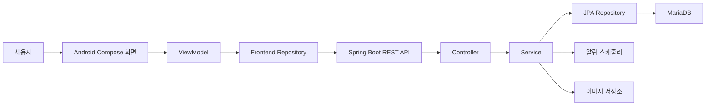
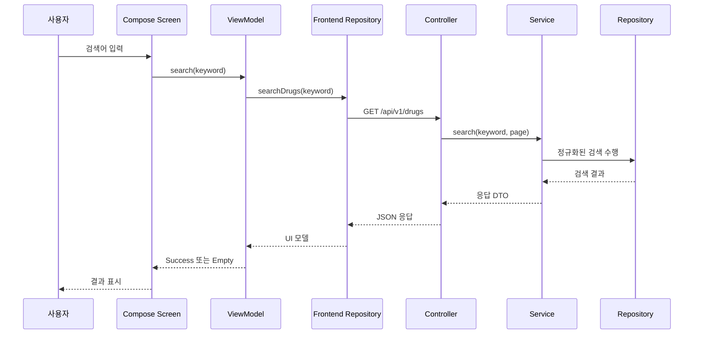
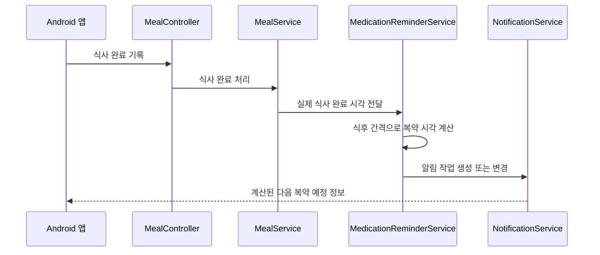

# AI 건강습관 MVP 시스템 아키텍처

작성일: 2026-10-13  
대상: 성준 백엔드, 현서 Android 프론트엔드  
개발 기간: 8주  
아키텍처 결정: Spring Boot MVC 계층형 REST API + Android MVVM

## 1. 문서 목적

이 문서는 AI 건강습관 MVP의 백엔드와 Android 앱 구조를 정의한다. 두 개발자가 AI 코딩 도구를 사용하더라도 동일한 책임 경계와 데이터 흐름을 유지하는 것이 목적이다.

핵심 원칙은 다음과 같다.

- 백엔드는 Spring MVC 기반의 REST API 서버로 구현한다.
- Android 앱은 Kotlin, Jetpack Compose, MVVM으로 구현한다.
- 프론트엔드는 MariaDB에 직접 접근하지 않는다.
- 인증, 권한, 복약시간 계산, 중복 방지 등 핵심 업무 규칙은 백엔드에서 처리한다.
- 프론트엔드는 사용자 입력, 화면 상태, API 호출과 결과 표시를 담당한다.
- 2개월 MVP이므로 복잡한 헥사고날·마이크로서비스 구조는 도입하지 않는다.

## 2. 전체 시스템 구조



### 기술 구성

| 영역 | 기술 | 책임자 |
|---|---|---|
| Android 앱 | Kotlin, Jetpack Compose, Material 3, MVVM | 현서 |
| 네트워크 | HTTPS, JSON REST API | 공동 |
| 백엔드 | Java, Spring Boot, Spring MVC | 성준 |
| 인증 | Spring Security, 토큰 기반 인증 | 성준 |
| 데이터 접근 | Spring Data JPA 또는 합의된 SQL 방식 | 성준 |
| 데이터베이스 | MariaDB 11.4 LTS | 성준 |
| 스키마 변경 | Flyway 또는 Liquibase | 성준 |
| API 문서 | OpenAPI | 성준 작성, 현서 확인 |
| 이미지 | 객체 저장소, DB에는 파일 키 저장 | 성준 |

## 3. 백엔드 아키텍처

### 3.1 적용 구조

Spring Boot 백엔드는 다음 계층을 사용한다.

```text
Client Request
    ↓
Controller
    ↓
Service
    ↓
Repository
    ↓
MariaDB
```

서버가 화면을 직접 렌더링하지 않으므로 전통적인 MVC의 View 템플릿은 사용하지 않는다. Controller가 Android 앱에 JSON을 반환한다.

### 3.2 계층별 책임

#### Controller

- HTTP 요청 수신
- 요청 DTO 형식 검증
- 로그인 사용자 식별
- Service 호출
- 응답 DTO와 HTTP 상태 반환
- 업무 계산을 직접 수행하지 않음
- Repository를 직접 호출하지 않음

```java
@RestController
@RequestMapping("/api/v1/drugs")
public class DrugDictionaryController {
    private final DrugDictionaryService drugDictionaryService;

    @GetMapping
    public PageResponse<DrugSummaryResponse> search(
            @RequestParam String keyword,
            @RequestParam(defaultValue = "0") int page) {
        return drugDictionaryService.search(keyword, page);
    }
}
```

#### Service

- 핵심 업무 규칙 처리
- 사용자 권한 검증
- 트랜잭션 경계 관리
- 여러 Repository 조합
- 일정과 예정 회차 계산
- 식후 복약 시각 계산
- 중복 요청과 상태 전환 검증
- Entity와 응답 DTO 변환

```java
@Service
@Transactional(readOnly = true)
public class DrugDictionaryService {
    private final MedicationProductRepository medicationProductRepository;

    public PageResponse<DrugSummaryResponse> search(String keyword, int page) {
        String normalizedKeyword = normalizeKeyword(keyword);
        return medicationProductRepository
                .search(normalizedKeyword, PageRequest.of(page, 20))
                .map(DrugSummaryResponse::from);
    }
}
```

#### Repository

- Entity 저장과 조회
- 조건 검색과 페이지네이션
- 필요한 경우 명시적 잠금 또는 중복 확인
- 업무 정책을 판단하지 않음
- Controller에서 직접 사용하지 않음

#### Entity

- MariaDB 테이블과 관계 매핑
- DB 무결성을 위한 최소한의 상태 보호
- API 응답으로 직접 반환하지 않음
- 화면 표시용 문구를 포함하지 않음

#### DTO

- 요청 DTO와 응답 DTO 분리
- Entity를 외부에 직접 노출하지 않음
- 필수값, 길이, 숫자 범위 등 형식 검증
- 화면에 불필요한 내부 컬럼 제외

#### Scheduler

- 습관 예정 회차 생성
- 복약 예정 회차 생성
- 발송할 알림 작업 조회
- 실패 작업의 제한적 재시도
- 업무 규칙 자체는 Service를 호출하여 적용

#### Security

- 로그인과 토큰 검증
- 사용자 식별자 주입
- 사용자별 데이터 접근 통제
- 공개 API와 보호 API 구분

### 3.3 백엔드 기능별 패키지 구조

프로젝트 전체를 계층별로 나누기보다 기능별로 묶는다.

```text
src/main/java/com/rootive/health/
├─ HealthApplication.java
├─ global/
│  ├─ config/
│  ├─ security/
│  ├─ exception/
│  ├─ response/
│  ├─ time/
│  └─ file/
├─ auth/
│  ├─ controller/
│  ├─ service/
│  ├─ repository/
│  ├─ entity/
│  └─ dto/
├─ user/
├─ habit/
├─ meal/
├─ medication/
├─ drugdictionary/
├─ notification/
├─ statistics/
└─ analytics/
```

기능 패키지 내부 예시는 다음과 같다.

```text
medication/
├─ controller/
│  └─ MedicationController.java
├─ service/
│  ├─ MedicationService.java
│  └─ MedicationScheduleService.java
├─ repository/
│  ├─ UserMedicationRepository.java
│  └─ MedicationScheduleRepository.java
├─ entity/
│  ├─ UserMedication.java
│  ├─ MedicationSchedule.java
│  └─ MedicationDoseOccurrence.java
├─ dto/
│  ├─ MedicationCreateRequest.java
│  ├─ MedicationResponse.java
│  └─ IntakeCreateRequest.java
└─ scheduler/
   └─ MedicationOccurrenceScheduler.java
```

### 3.4 백엔드 의존 방향

허용되는 의존 방향:

```text
Controller → Service → Repository → Entity
                       ↓
                    MariaDB
```

허용하지 않는 구조:

```text
Controller → Repository
Repository → Service
Entity → Controller
```

기능 간 호출이 필요하면 다른 기능의 Repository를 직접 조합하기보다 해당 기능의 Service 또는 별도 조정 Service를 사용한다.

예시:

```text
MealService
    ↓ 식사 완료 이벤트
MedicationReminderService
    ↓
NotificationService
```

## 4. Android MVVM 아키텍처

### 4.1 적용 구조

```text
Compose Screen
    ↓ 사용자 이벤트
ViewModel
    ↓
Frontend Repository
    ↓
Remote Data Source / API
    ↓
Spring Boot
```

### 4.2 구성요소별 책임

#### Compose Screen

- 화면 표시
- 사용자 입력 수집
- ViewModel 상태 관찰
- 버튼과 입력 이벤트를 ViewModel에 전달
- API를 직접 호출하지 않음
- 복약시간 등 업무 규칙을 계산하지 않음

#### ViewModel

- 화면 상태 보관
- 사용자 이벤트 처리
- Repository 호출
- 로딩·성공·빈 결과·오류 상태 전환
- 동일 버튼의 중복 요청 방지
- Android 화면 회전 등에도 필요한 상태 유지

#### Frontend Repository

- API 호출 방법을 화면에서 숨김
- 응답 DTO를 화면 모델로 변환
- 공통 오류 변환
- 향후 Mock과 실제 API 구현을 교체할 수 있는 경계

#### Remote Data Source

- 실제 HTTP 요청
- 인증 헤더 적용
- 요청·응답 직렬화
- HTTP 상태와 네트워크 오류 전달

#### UI State

한 화면의 상태를 명확하게 표현한다.

```kotlin
sealed interface DrugSearchUiState {
    data object Idle : DrugSearchUiState
    data object Loading : DrugSearchUiState
    data class Success(val items: List<DrugSummaryUiModel>) : DrugSearchUiState
    data object Empty : DrugSearchUiState
    data class Error(val message: String) : DrugSearchUiState
}
```

### 4.3 Android 패키지 구조

```text
app/src/main/java/com/rootive/health/
├─ app/
│  ├─ HealthApplication.kt
│  └─ MainActivity.kt
├─ core/
│  ├─ network/
│  ├─ auth/
│  ├─ model/
│  ├─ ui/
│  ├─ navigation/
│  └─ util/
├─ feature/
│  ├─ auth/
│  ├─ home/
│  ├─ habit/
│  ├─ meal/
│  ├─ medication/
│  ├─ drugdictionary/
│  ├─ statistics/
│  └─ settings/
```

기능 내부 예시는 다음과 같다.

```text
feature/drugdictionary/
├─ data/
│  ├─ DrugDictionaryApi.kt
│  ├─ DrugDictionaryRepository.kt
│  └─ DrugDictionaryRepositoryImpl.kt
├─ model/
│  ├─ DrugSummaryDto.kt
│  └─ DrugSummaryUiModel.kt
├─ viewmodel/
│  ├─ DrugSearchUiState.kt
│  └─ DrugSearchViewModel.kt
└─ ui/
   ├─ DrugSearchScreen.kt
   ├─ DrugDetailScreen.kt
   └─ DrugResultItem.kt
```

### 4.4 Android 의존 방향

허용되는 의존 방향:

```text
Screen → ViewModel → Repository → API
```

허용하지 않는 구조:

```text
Screen → API
API → ViewModel
Repository → Compose Screen
```

## 5. 백엔드와 프론트엔드 연결 규칙

### 5.1 API 계약 우선

구현 전에 다음 항목을 고정한다.

- URL과 HTTP 메서드
- 요청 JSON
- 성공 응답 JSON
- 공통 오류 응답
- 필수값과 선택값
- 상태 코드 목록
- 날짜와 시간 형식
- 페이지네이션 형식

### 5.2 공통 성공 응답 예시

```json
{
  "data": {
    "id": "018f6d15-6b55-7f10-a168-4b70b7adfd92",
    "name": "예시 의약품"
  },
  "traceId": "7b3470e0f0b142e7"
}
```

### 5.3 공통 오류 응답 예시

```json
{
  "code": "VALIDATION_ERROR",
  "message": "입력값을 확인해 주세요.",
  "fieldErrors": [
    {
      "field": "doseAmount",
      "reason": "0보다 커야 합니다."
    }
  ],
  "traceId": "7b3470e0f0b142e7"
}
```

### 5.4 날짜와 시간

- 서버 저장: UTC `DATETIME(6)`
- API 전달: ISO 8601 시간대 포함 문자열
- 앱 표시: 사용자 시간대 기준
- 실제 행동 시각과 앱 기록 시각을 별도 필드로 전달

```json
{
  "actualAt": "2026-10-13T12:40:00+09:00",
  "recordedAt": "2026-10-13T13:05:12+09:00"
}
```

## 6. 주요 기능별 처리 위치

| 기능 | Android | Spring Boot |
|---|---|---|
| 이메일 형식 확인 | 1차 검사 | 최종 검사 및 중복 확인 |
| 사용자 인증 | 토큰 보관·전달 | 발급·검증·권한 판단 |
| 습관 상태 표시 | 서버 상태 표시 | 상태 전환 검증·저장 |
| 영양 합계 | 서버 결과 표시 | 섭취량 기반 계산·저장 |
| 식후 복약시간 | 서버 결과 표시 | 실제 식사 완료 시각 기준 계산 |
| 중복 복용 방지 | 버튼 중복 입력 방지 | 멱등성·DB 제약으로 최종 방지 |
| 의약품 검색 | 검색어 입력·결과 표시 | 검색·정렬·페이지네이션 |
| 알림 | 권한 요청·알림 표시 | 발송 조건·작업·재알림 판단 |
| 통계 | 차트·숫자 표시 | 집계와 지표 계산 |
| 분석 이벤트 | 이벤트 전달 | 수신·검증·저장 |

## 7. 기능 처리 예시

### 7.1 의약품 사전 검색



### 7.2 식후 복약 알림



프론트엔드는 `식후 30분`을 직접 더해서 최종 시간을 만들지 않는다. 서버가 계산한 예정 시각을 표시한다.

### 7.3 습관 완료

```text
완료 버튼 선택
→ ViewModel이 버튼 비활성화 및 로딩 표시
→ 완료 API 호출
→ 서버가 사용자·회차·현재 상태·중복 요청 검증
→ 행동 이벤트와 현재 상태 저장
→ 연결된 재알림 작업 취소
→ 최신 회차 상태 반환
→ ViewModel이 화면 갱신
```

## 8. 테스트 구조

### 백엔드

- Controller 테스트: 요청 검증과 HTTP 응답
- Service 단위 테스트: 상태 전환과 시간 계산
- Repository 테스트: 검색, 제약조건, 페이지네이션
- 통합 테스트: 인증부터 DB 저장까지
- 권한 테스트: 다른 사용자의 데이터 접근 차단
- 멱등성 테스트: 동일 요청의 중복 저장 방지

```text
src/test/java/com/rootive/health/
├─ auth/
├─ habit/
├─ meal/
├─ medication/
├─ drugdictionary/
└─ integration/
```

### Android

- ViewModel 테스트: 로딩·성공·빈 결과·오류 상태
- Repository 테스트: API 응답 변환
- Compose UI 테스트: 입력과 화면 전환
- 실제 단말 테스트: 네트워크, 사진, 키보드, 알림 권한

## 9. Git 협업 구조

### 권장 브랜치

```text
main
├─ backend/feature-drug-search
├─ backend/feature-meal-record
├─ frontend/feature-drug-search
└─ frontend/feature-meal-record
```

실제 저장소를 백엔드와 Android로 분리하면 각 저장소에서 `feature/...` 형식을 사용한다.

### 병합 전 확인

- 프로젝트가 빌드되는가?
- 자동 테스트가 통과하는가?
- API 계약이 변경되었는가?
- 비밀정보가 포함되지 않았는가?
- 화면 또는 서버의 정상·오류 시나리오가 확인되었는가?
- DB 마이그레이션이 이전 버전에서도 적용되는가?

## 10. AI 코딩 도구 사용 규칙

### 성준

- AI가 생성한 Entity 관계와 트랜잭션 범위를 검토한다.
- 인증·인가 코드는 테스트 없이 채택하지 않는다.
- AI가 기존 마이그레이션을 수정하게 하지 않고 새 버전을 추가한다.
- 전체 설계 59개 테이블을 한 번에 구현하도록 요청하지 않는다.

### 현서

- AI Studio에는 한 화면 또는 한 기능 단위로 요청한다.
- 생성 코드가 빌드되는지 즉시 확인한다.
- AI가 API 필드명과 상태값을 임의로 만들지 않도록 실제 계약을 제공한다.
- API 키, 토큰, DB 정보를 프롬프트와 소스에 넣지 않는다.
- 모든 코드를 한 파일에 생성하면 기능별 구조로 분리하도록 요청한다.

## 11. 2개월 MVP에서 사용하지 않을 구조

다음 구조는 장기 확장 시 검토할 수 있지만 이번 MVP에는 적용하지 않는다.

- 마이크로서비스
- 이벤트 브로커 중심 분산 시스템
- 복잡한 CQRS
- 모든 기능에 대한 다중 모듈 분리
- 과도한 인터페이스와 추상 계층
- 오프라인 우선 양방향 동기화
- 앱 내부의 별도 업무 규칙 엔진

현재 구조가 커져 다음 조건이 발생하면 헥사고날 또는 모듈형 구조로 전환을 검토한다.

- 외부 연동 제공자가 여러 개로 증가
- 병원 연계가 실제 서비스 범위에 포함
- 복약·알림 규칙이 독립 배포가 필요할 정도로 복잡해짐
- 여러 팀이 같은 백엔드를 동시에 개발
- 비동기 이벤트 처리량이 크게 증가

## 12. 최종 결정

```text
백엔드: Spring Boot MVC 기반 REST API
구조: 기능별 패키지 + Controller → Service → Repository

Android: Kotlin + Jetpack Compose + MVVM
구조: Screen → ViewModel → Repository → API

데이터베이스: MariaDB
연결 방식: HTTPS JSON REST API
핵심 업무 규칙: Spring Boot Service
화면 상태와 사용자 상호작용: Android ViewModel
```

이 구조를 8주 MVP의 기준으로 사용하고, 개발 중 구조 변경이 필요한 경우 두 담당자가 API·DB·일정에 미치는 영향을 먼저 검토한다.

