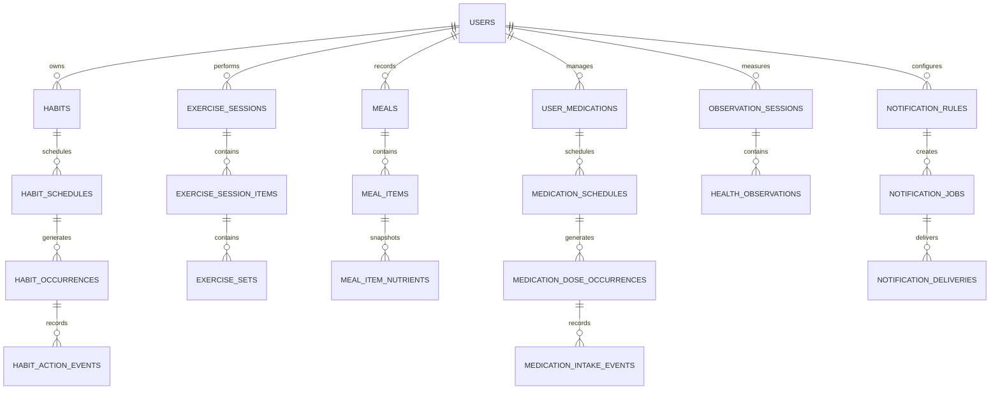

# AI 건강습관 서비스 데이터베이스 설계 v2

기준일: 2026-10-06  
대상 DBMS: MariaDB 11.4 LTS / InnoDB / utf8mb4_uca1400_ai_ci  
적용 범위: 현재 DDL에 포함된 59개 테이블  
상세 컬럼 정의: `health_habit_data_dictionary.md`  
실행 DDL: `health_habit_mariadb_schema.sql`

## 1. 문서 목적과 범위

이 문서는 AI 건강습관 서비스에서 현재 구현 대상으로 확정한 데이터베이스 구조를 설명한다. 회원, 습관, 운동, 식사, 복약, 신체측정, 알림, 목표·보상, 분석·AI, 외부·병원 연계, 감사 영역을 포함한다.

현재 구조는 **59개 테이블, 394개 컬럼, 86개 외래키, 14개 CHECK 제약조건**으로 구성된다. 이 문서에는 현재 DDL에 존재하지 않는 후보 테이블을 포함하지 않는다. 이후 기능이 확정되면 별도 버전에서 테이블을 추가한다.

## 2. 기술 기준

| 항목 | 적용 기준 |
|---|---|
| DBMS | MariaDB 11.4 LTS |
| 스토리지 엔진 | InnoDB |
| 문자셋·정렬 | utf8mb4 / utf8mb4_uca1400_ai_ci |
| 기본키 | 애플리케이션에서 생성한 UUID를 BINARY(16)으로 저장 |
| 시간 | DATETIME(6)에 UTC로 저장하고 사용자 시간대로 변환 |
| 가변 데이터 | MariaDB JSON 별칭 사용. 실제 저장은 LONGTEXT와 JSON 유효성 검사 방식 |
| 삭제 정책 | 복구가 필요한 주요 사용자 데이터는 deleted_at으로 논리 삭제 |
| 민감정보 추적 | audit_logs에 조회·변경·전송 행위를 기록 |

### MariaDB 구현 규칙

- MySQL 전용 `UUID_TO_BIN(uuid, 1)`과 `BIN_TO_UUID(id, 1)`에 의존하지 않는다.
- UUID 문자열과 16바이트 값의 변환은 애플리케이션 계층에서 처리한다.
- 모든 업무 일시는 UTC로 저장하고 반복 일정에는 IANA 시간대와 현지 시각을 별도로 보관한다.
- 상태값은 VARCHAR와 CHECK 제약 또는 애플리케이션 코드 사전으로 관리한다.
- JSON 내부에서 자주 검색하는 값은 PERSISTENT(STORED) 생성 컬럼으로 추출한 뒤 인덱스를 적용한다.
- 사진과 처방전 원본은 객체 스토리지에 저장하고 데이터베이스에는 파일 키와 메타데이터만 저장한다.
- 계획, 예정 회차, 실제 행동 기록을 분리하여 재알림·지연·수정 이력을 재현할 수 있게 한다.

## 3. 영역별 테이블 수

| 영역 | 테이블 수 | 주요 책임 |
|---|---:|---|
| 회원 | 3 | 계정, 프로필, 동의 이력 |
| 공통 사전 | 10 | 카테고리, 단위, 영양소, 알레르기, 운동, 약 성분, 측정 항목, 의료기관 |
| 습관 | 7 | 습관 정의, 반복 일정, 예정 회차, 행동 이력 |
| 운동 | 4 | 운동 종목, 세션, 세션 항목, 세트 기록 |
| 식사 | 7 | 음식, 영양소, 알레르기, 식사와 섭취 스냅샷 |
| 복약 | 11 | 약품 사전, 처방, 복약 일정, 실제 복용, 재고 |
| 신체측정 | 2 | 측정 세션과 항목별 값 |
| 알림 | 5 | 알림 정책, 대상, 발송 작업, 발송 결과 |
| 목표·보상 | 2 | 건강 목표와 경험치·포인트 원장 |
| 분석·AI | 3 | 행동 이벤트와 AI 작업·결과 |
| 외부·병원 연계 | 4 | 외부 연결, 레코드 매핑, 병원 연결과 동의 |
| 감사 | 1 | 민감정보 접근·변경 감사 로그 |
| **합계** | **59** | 현재 DDL 전체 |

## 4. 전체 관계 개요

## 5. 회원 영역 3개

| 테이블 | 역할 | 핵심 관계와 설계 포인트 |
|---|---|---|
| `users` | 로그인 계정, 계정 상태, 언어와 시간대 관리 | 모든 사용자 소유 데이터의 기준 테이블이다. 이메일은 `email_normalized`에 UNIQUE를 적용한다. |
| `user_profiles` | 닉네임, 생년월일, 성별, 키 등 일반 프로필 관리 | `users`와 1:1 관계이며 민감한 건강 기록과 분리한다. |
| `user_consents` | 약관·개인정보·건강정보 처리 동의와 철회 이력 | 사용자, 동의 유형, 버전 조합으로 동일 동의의 중복 생성을 방지한다. |

## 6. 공통 사전 영역 10개

| 테이블 | 역할 | 핵심 관계와 설계 포인트 |
|---|---|---|
| `habit_categories` | 운동·식사·복약 등 습관 분류 정의 | 습관과 통계 분류에서 공통으로 참조한다. |
| `unit_definitions` | g, mg, ml, kcal, 회 등 단위와 기준 단위 변환정보 관리 | 영양·운동·복약·측정 값의 단위를 통합한다. |
| `nutrient_definitions` | 열량·탄수화물·단백질·지방·당·카페인 정의 | 기본 단위를 `unit_definitions`로 참조한다. |
| `allergens` | 알레르기 성분 코드와 표시명 관리 | 음식 알레르기와 사용자 보유 알레르기의 공통 기준이다. |
| `exercise_categories` | 운동 대분류와 세부분류 관리 | 자기참조 `parent_code`로 계층을 구성한다. |
| `dosage_form_definitions` | 정제·캡슐·액상·분말 등 제형 정의 | 의약품과 보충제 제품의 제형 기준이다. |
| `medication_ingredients` | 의약품·영양제·보충제 성분 사전 | 제품 구성 성분과 성분 간 상호작용에서 참조한다. |
| `observation_types` | 체중·혈압·혈당·심박 등 측정 항목 정의 | 숫자형 또는 문자형 값 형식과 표시 순서를 관리한다. |
| `observation_type_units` | 측정 항목별 허용 단위와 기본 단위 관리 | 측정 항목과 단위의 다대다 관계이며 유효한 조합만 허용한다. |
| `healthcare_institutions` | 향후 병원 연계를 위한 의료기관 마스터 | 처방과 의료기관 연결에서 공통으로 참조한다. |

## 7. 습관 영역 7개

| 테이블 | 역할 | 핵심 관계와 설계 포인트 |
|---|---|---|
| `habits` | 사용자가 관리하는 습관의 이름, 상태, 기간과 우선순위 저장 | 사용자와 습관 카테고리를 참조하며 논리 삭제를 지원한다. |
| `habit_schedules` | 반복 유형, 간격, 시간대와 적용 기간을 버전별로 관리 | 하나의 습관에 여러 일정 버전을 둘 수 있다. |
| `habit_schedule_days` | 요일 기반 반복 일정 저장 | 일정과 요일을 복합 기본키로 관리하며 요일은 1~7만 허용한다. |
| `habit_schedule_times` | 하루 안의 여러 수행 시각과 순서 저장 | 일정별 `sequence_no`를 UNIQUE로 관리한다. |
| `habit_schedule_exceptions` | 특정 날짜의 제외·휴식·대체 시각 관리 | 일정과 날짜 조합의 중복을 방지한다. |
| `habit_occurrences` | 일정에서 생성된 개별 예정 회차와 현재 상태 저장 | 일정·예정 시각 조합이 유일하며 알림과 실제 기록의 연결점이다. |
| `habit_action_events` | 완료·미루기·건너뛰기·수정 행동 이력 저장 | `actual_at`과 `recorded_at`을 분리하고 이전 이벤트를 자기참조하여 수정 이력을 보존한다. |

## 8. 운동 영역 4개

| 테이블 | 역할 | 핵심 관계와 설계 포인트 |
|---|---|---|
| `exercise_definitions` | 사용자가 선택할 수 있는 운동 종목 사전 | 운동 세부분류와 기본 측정 방식을 참조한다. |
| `exercise_sessions` | 한 번의 운동 시작·종료·총 칼로리 기록 | 사용자와 선택적으로 습관 예정 회차를 연결한다. |
| `exercise_session_items` | 운동 세션 안에서 수행한 종목과 순서 기록 | 세션과 운동 종목을 연결한다. |
| `exercise_sets` | 세트별 중량·횟수·시간·거리·휴식 기록 | 세션 항목별 `set_no`를 UNIQUE로 관리하고 각 값의 단위를 참조한다. |

## 9. 식사 영역 7개

| 테이블 | 역할 | 핵심 관계와 설계 포인트 |
|---|---|---|
| `foods` | 공공 데이터·관리자·사용자가 등록한 음식 기본정보 관리 | 사용자 등록 음식은 `owner_user_id`로 소유자를 구분하고 검증 상태를 저장한다. |
| `food_nutrients` | 음식의 기준 섭취량당 영양소 값 저장 | 음식·영양소·단위를 연결하여 탄·단·지·당·카페인·칼로리를 표현한다. |
| `food_allergens` | 음식에 포함되거나 포함 가능성이 있는 알레르기 관리 | 음식과 알레르기 성분을 연결하고 정보 출처와 검증 시각을 저장한다. |
| `meals` | 식사 유형, 실제 섭취시각과 기록 상태 관리 | 사용자와 선택적으로 습관 예정 회차를 연결한다. |
| `meal_items` | 한 끼에 포함된 음식과 실제 섭취량 기록 | 식사, 음식, 섭취 단위를 연결한다. |
| `meal_item_nutrients` | 섭취 당시 계산된 영양값 스냅샷 저장 | 음식 정보가 변경되어도 과거 통계가 바뀌지 않도록 값을 보존한다. |
| `user_allergies` | 사용자의 알레르기 성분, 반응 등급과 증상 관리 | 사용자·알레르기 조합을 UNIQUE로 관리한다. |

## 10. 복약 영역 11개

| 테이블 | 역할 | 핵심 관계와 설계 포인트 |
|---|---|---|
| `medication_products` | 처방약·일반약·영양제·운동 보충제 제품 사전 | 제형, 제조사, 외부 식별코드와 표시정보를 관리한다. |
| `medication_product_ingredients` | 제품과 성분의 다대다 관계 및 함량 관리 | 함량 단위는 공통 단위 사전을 참조한다. |
| `medication_ingredient_interactions` | 두 성분 간 상호작용 수준과 근거 관리 | 동일 성분의 자기 상호작용을 CHECK로 차단하고 정렬된 성분 쌍을 저장한다. |
| `prescriptions` | 한 번의 처방과 의료기관·처방일·처방기간 관리 | 사용자와 선택적으로 의료기관을 연결한다. |
| `user_medications` | 사용자가 실제 복용하는 약·영양제·보충제 관리 | 제품 또는 처방과 연결하며 직접 입력 항목도 허용한다. |
| `medication_schedules` | 복용 횟수, 간격, 식사 관계와 적용 기간을 버전별로 관리 | 사용자 복약 항목별 일정 변경 이력을 보존한다. |
| `medication_schedule_days` | 요일 기반 복약 일정 저장 | 일정과 요일을 복합 기본키로 관리한다. |
| `medication_schedule_times` | 회차별 시각, 복용량, 단위와 식사 기준 저장 | 일정별 순서를 UNIQUE로 관리하고 복용량은 양수만 허용한다. |
| `medication_dose_occurrences` | 일정에서 생성된 개별 예정 복용 회차와 현재 상태 저장 | 일정·예정 시각 조합이 유일하다. |
| `medication_intake_events` | 실제 복용·건너뜀·약 없음·수정 행동 이력 저장 | 실제 복용시각과 앱 기록시각을 분리하고 이전 이벤트 자기참조로 변경 이력을 보존한다. |
| `medication_inventory_transactions` | 입고·복용·수정·폐기 등 재고 증감 원장 | 잔여량을 직접 덮어쓰지 않고 거래 합계로 계산한다. |

## 11. 신체측정 영역 2개

| 테이블 | 역할 | 핵심 관계와 설계 포인트 |
|---|---|---|
| `observation_sessions` | 같은 시점과 출처에서 입력된 측정값 묶음 관리 | 사용자, 측정시각, 입력 출처와 선택적 컨텍스트 JSON을 저장한다. |
| `health_observations` | 체중·체지방·혈압·혈당·심박·체온 등 개별 측정값 저장 | 숫자값과 문자값 중 하나만 존재하도록 CHECK를 적용하고 항목별 허용 단위를 검증한다. |

## 12. 알림 영역 5개

| 테이블 | 역할 | 핵심 관계와 설계 포인트 |
|---|---|---|
| `notification_rules` | 최초 알림·재알림 간격·최대 횟수와 활성 상태 관리 | 사용자별 알림 정책을 정의한다. |
| `notification_rule_habit_targets` | 알림 정책과 습관 대상 연결 | 다형 참조 대신 실제 습관 외래키를 사용한다. |
| `notification_rule_medication_targets` | 알림 정책과 사용자 복약 항목 연결 | 다형 참조 대신 실제 복약 외래키를 사용한다. |
| `notification_jobs` | 발송 예정 시각, 작업 상태와 재시도 차수 관리 | 습관 회차와 복약 회차 중 정확히 하나만 연결되도록 CHECK를 적용한다. |
| `notification_deliveries` | 제공자별 실제 발송·도착·열람·실패 결과 기록 | 한 작업의 여러 발송 시도를 보존하고 제공자 메시지 ID 중복을 방지한다. |

## 13. 목표와 보상 영역 2개

| 테이블 | 역할 | 핵심 관계와 설계 포인트 |
|---|---|---|
| `goals` | 운동·식사·체중·습관의 장기·단기 목표 관리 | 목표값·단위·기간·상태를 사용자 기준으로 저장한다. |
| `reward_ledger` | 경험치와 포인트의 지급·사용·취소 원장 관리 | 잔액을 직접 수정하지 않고 거래 합계로 계산하며 취소 거래는 원거래를 자기참조한다. |

## 14. 분석과 AI 영역 3개

| 테이블 | 역할 | 핵심 관계와 설계 포인트 |
|---|---|---|
| `analytics_events` | 화면 조회, 기능 사용, 알림 반응 등 제품 분석 이벤트 저장 | 익명 사용자도 허용하며 발생시각과 수신시각을 분리하고 속성은 JSON으로 저장한다. |
| `ai_jobs` | 음식·약 사진 분석, OCR, 추천, 요약 등 비동기 작업 관리 | 사용자, 작업 유형, 상태, 모델과 처리시간을 저장한다. |
| `ai_job_outputs` | AI 구조화 결과, 신뢰도, 안전 플래그와 채택 여부 저장 | 원본 업무 데이터와 분리하며 한 작업의 결과 버전을 보존할 수 있다. |

## 15. 외부와 병원 연계 영역 4개

| 테이블 | 역할 | 핵심 관계와 설계 포인트 |
|---|---|---|
| `integration_connections` | Health Connect·웨어러블·캘린더 등 외부 제공자 연결 관리 | 사용자·제공자 조합을 UNIQUE로 관리하고 권한 범위와 연결 상태를 저장한다. |
| `external_record_mappings` | 외부 레코드와 내부 레코드 ID 매핑 | 연결·외부 ID 조합을 UNIQUE로 관리하여 중복 수집을 방지한다. |
| `healthcare_connections` | 사용자와 의료기관 사이의 연결 상태 관리 | 사용자와 의료기관을 참조하고 연결·해제 시각을 보존한다. |
| `healthcare_data_consents` | 병원 연계 목적, 데이터 범위와 유효기간별 동의 관리 | 병원 연결별 동의·철회 이력을 저장한다. |

## 16. 감사 영역 1개

| 테이블 | 역할 | 핵심 관계와 설계 포인트 |
|---|---|---|
| `audit_logs` | 민감정보 조회·변경·전송 등 보안 감사 행위 기록 | 시스템·관리자·사용자 등 다양한 행위자를 기록할 수 있도록 행위자와 대상은 식별자 형태로 보존한다. |

## 17. 핵심 데이터 흐름

### 습관 실행

1. `habits`에 습관 기본정보를 생성한다.
2. `habit_schedules`, `habit_schedule_days`, `habit_schedule_times`에 반복 규칙을 저장한다.
3. 스케줄러가 `habit_occurrences`에 예정 회차를 생성한다.
4. 사용자의 완료·미루기·건너뛰기 행동을 `habit_action_events`에 추가한다.
5. 현재 화면은 회차 상태를 조회하고, 변경 이력은 이벤트를 통해 재현한다.

### 복약 실행과 재고

1. `medication_products`와 성분 관계에서 약품 기준정보를 조회한다.
2. 사용자의 실제 복약 항목을 `user_medications`에 생성한다.
3. 반복 규칙과 회차별 용량을 `medication_schedules` 계열에 저장한다.
4. 예정 복용 회차를 `medication_dose_occurrences`에 생성한다.
5. 실제 행동을 `medication_intake_events`에 기록한다.
6. 실제 복용량에 따른 재고 증감을 `medication_inventory_transactions`에 추가한다.

### 식사와 영양 분석

1. 음식 기준정보를 `foods`, `food_nutrients`, `food_allergens`에서 관리한다.
2. 사용자의 식사를 `meals`와 `meal_items`에 기록한다.
3. 섭취 당시 계산된 영양값을 `meal_item_nutrients`에 스냅샷으로 저장한다.
4. 알레르기 경고는 `user_allergies`와 `food_allergens`를 비교하여 생성한다.

### 알림과 행동 전환 분석

1. `notification_rules`와 대상 관계 테이블에 재알림 정책을 저장한다.
2. 각 습관·복약 회차별 발송 작업을 `notification_jobs`에 생성한다.
3. 실제 발송 결과를 `notification_deliveries`에 누적한다.
4. 회차 행동 이벤트 및 `analytics_events`와 결합하여 알림 후 완료율과 반응시간을 계산한다.

## 18. 주요 무결성 규칙

- 습관과 복약의 요일은 1~7 범위만 허용한다.
- 일정별 회차 순서는 양수이며 중복될 수 없다.
- 운동 세트 번호는 종목별로 중복될 수 없다.
- 복용량과 재고 거래량은 공통 단위 사전을 참조한다.
- 신체측정 값은 숫자값과 문자값 중 정확히 하나만 저장한다.
- 신체측정 항목과 단위는 `observation_type_units`에 등록된 조합만 허용한다.
- 알림 작업은 습관 회차 또는 복약 회차 중 하나에만 연결한다.
- 상호작용 성분 두 개는 서로 달라야 한다.
- 수정·취소는 기존 기록을 덮어쓰지 않고 이전 이벤트 또는 원거래를 참조하는 새 행으로 추가한다.

## 19. 주요 인덱스

- `users(email_normalized)` UNIQUE
- `habit_occurrences(schedule_id, scheduled_at)` UNIQUE
- `habit_action_events(idempotency_key)` UNIQUE
- `medication_dose_occurrences(schedule_id, scheduled_at)` UNIQUE
- `medication_intake_events(idempotency_key)` UNIQUE
- `notification_jobs(status, scheduled_at)` INDEX
- `notification_deliveries(provider_message_id)` UNIQUE
- `reward_ledger(user_id, occurred_at)` INDEX
- `analytics_events(user_id, occurred_at)` INDEX
- `analytics_events(event_name, occurred_at)` INDEX
- `integration_connections(user_id, provider)` UNIQUE
- `external_record_mappings(connection_id, external_id)` UNIQUE

## 20. 보안과 데이터 보존

- 비밀번호는 Argon2id 등 검증된 단방향 해시만 저장한다.
- 인증 토큰과 외부 연동 토큰은 원문으로 저장하지 않고 암호화 또는 별도 비밀 저장소를 사용한다.
- 복약·측정·알레르기 데이터는 최소 권한으로 접근하고 조회·변경 이력을 `audit_logs`에 남긴다.
- 분석 이벤트와 AI 입출력에는 자유입력 건강정보 원문을 불필요하게 복제하지 않는다.
- 회원 탈퇴 시 법적 보존 대상과 즉시 삭제 대상을 구분하고 사용자 식별정보는 삭제 또는 가명화한다.
- 처방전·음식·약 사진은 객체 스토리지에 저장하고 보존기간 만료 시 원본과 파생 데이터를 함께 삭제한다.

## 21. 구현 순서

1. 회원과 공통 사전 테이블을 생성한다.
2. 습관 일정·회차·행동 이벤트를 구현한다.
3. 운동·식사·복약·신체측정 기록을 연결한다.
4. 알림 정책·작업·발송 결과를 연결한다.
5. 목표·보상 원장과 분석 이벤트를 추가한다.
6. AI 작업 파이프라인을 연결한다.
7. 외부 연동과 병원 연계 테이블은 실제 연계 계약과 동의 정책 확정 후 활성화한다.
8. 감사 로그와 보존·삭제 배치를 적용한 뒤 운영 전 무결성 테스트를 수행한다.
