# AI 건강습관 DB 추가 정규화 설계 v2

기준 DB: MariaDB 11.4 LTS / InnoDB / utf8mb4_uca1400_ai_ci  
목표: 핵심 업무 데이터 3NF, 코드·단위·성분의 참조 무결성 확보

적용 상태: `health_habit_core_schema.dbml`, 일반 DDL, 주석 포함 DDL, 데이터 사전에 반영 완료. 현재 기준 구조는 59개 테이블·394개 컬럼이다.

## 1. 정규화 범위

v2에서 기존 구조에 추가 정규화를 적용한 영역은 다음과 같다.

1. 단위 공통 사전
2. 영양소 공통 사전
3. 알레르기 사전과 음식-알레르기 관계
4. 운동 대분류·세부분류
5. 의약품 성분과 제품-성분 관계
6. 신체측정 항목과 허용 단위
7. 습관 반복요일·실행시각
8. 복약 반복요일·회차별 복용량·식사 관계
9. 알림 대상의 다형 참조 제거

분석 이벤트 속성, AI 입출력, 외부 API 원문처럼 구조가 자주 바뀌는 데이터는 JSON으로 유지한다.

## 2. 공통 단위 사전

v1에서는 `unit`, `dose_unit`, `basis_unit`, `unit_code`가 여러 테이블에 문자열로 반복되었다. v2에서는 모든 업무 단위가 `unit_definitions`를 참조한다.

### unit_definitions

| 컬럼 | 타입 | 설명 |
|---|---|---|
| code | VARCHAR(32) PK | `g`, `mg`, `ml`, `kcal`, `kg`, `mmHg`, `count` 등 단위 코드 |
| name | VARCHAR(100) | 단위 한글명 |
| symbol | VARCHAR(32) | 화면 표시 기호 |
| dimension_code | VARCHAR(32) | mass, volume, energy, pressure, count 등 단위 차원 |
| canonical_factor | DECIMAL(24,12) | 같은 차원의 기준 단위로 변환하기 위한 계수 |
| decimal_scale | TINYINT | 표시 소수점 자릿수 |
| active | TINYINT(1) | 사용 여부 |

정규화 후 다음 컬럼이 `unit_definitions.code`를 참조한다.

- `food_nutrients.basis_unit_code`
- `meal_items.unit_code`
- `medication_product_ingredients.unit_code`
- `medication_schedule_times.dose_unit_code`
- `medication_intake_events.unit_code`
- `medication_inventory_transactions.unit_code`
- `health_observations.unit_code`
- `goals.unit_code`

## 3. 영양소

### nutrient_definitions

| 컬럼 | 타입 | 설명 |
|---|---|---|
| code | VARCHAR(32) PK | calorie, carbohydrate, protein, fat, sugar, caffeine |
| name | VARCHAR(100) | 영양소 표시명 |
| canonical_unit_code | VARCHAR(32) FK | 기본 집계 단위 |
| nutrient_group | VARCHAR(32) | macro, sugar, stimulant, energy 등 |
| parent_code | VARCHAR(32) FK | 첨가당·유리당처럼 상위 영양소와 연결할 때 사용 |
| included_in_total | TINYINT(1) | 상위 합계에 포함되는지 여부 |
| active | TINYINT(1) | 서비스 제공 여부 |

### 정규화된 food_nutrients

```text
food_nutrients
- food_id PK, FK
- nutrient_code PK, FK
- amount
- basis_quantity
- basis_unit_code FK
```

### 정규화된 meal_item_nutrients

```text
meal_item_nutrients
- meal_item_id PK, FK
- nutrient_code PK, FK
- amount
- source_type
- calculated_at
```

음식 사전 값이 수정되어도 과거 식사 통계가 변경되지 않도록 `meal_item_nutrients` 스냅샷은 유지한다. 이는 의도적인 비정규화가 아니라 시점 데이터 보존이다.

## 4. 알레르기

### allergens

| 컬럼 | 타입 | 설명 |
|---|---|---|
| code | VARCHAR(32) PK | 우유·난류·땅콩·갑각류 등 알레르기 코드 |
| name | VARCHAR(100) | 사용자 표시명 |
| description | VARCHAR(500) | 포함 성분과 주의사항 |
| active | TINYINT(1) | 사용 여부 |

### food_allergens

| 컬럼 | 타입 | 설명 |
|---|---|---|
| food_id | BINARY(16) PK, FK | 대상 음식 |
| allergen_code | VARCHAR(32) PK, FK | 알레르기 성분 |
| presence_type | VARCHAR(32) | 포함·함유가능·교차오염 가능 |
| source_type | VARCHAR(32) | 공공데이터·제품표기·사용자등록·관리자검토 |
| verified_at | DATETIME(6) | 검토 완료시각 |

`user_allergies.allergen_code`와 `food_allergens.allergen_code`가 같은 알레르기 사전을 참조한다.

## 5. 운동 분류

### exercise_categories

| 컬럼 | 타입 | 설명 |
|---|---|---|
| code | VARCHAR(64) PK | 운동 분류 코드 |
| parent_code | VARCHAR(64) FK | 상위 분류 코드 |
| name | VARCHAR(100) | 분류명 |
| level | TINYINT | 1=대분류, 2=세부분류 |
| active | TINYINT(1) | 선택 가능 여부 |

예시:

```text
STRENGTH       근력운동
STRENGTH_CHEST 가슴운동
CARDIO         유산소
CARDIO_RUNNING 러닝
```

`exercise_definitions.category_code`는 `exercise_categories.code`를 참조한다.

## 6. 의약품 성분

v2에서 `medication_products.ingredient_text`는 검색·표시용 원문으로만 유지하고 실제 성분 관계는 별도 테이블로 분리했다.

### medication_ingredients

| 컬럼 | 타입 | 설명 |
|---|---|---|
| id | BINARY(16) PK | 성분 식별자 |
| external_code | VARCHAR(128) UNIQUE | 공공 의약품 데이터의 성분 코드 |
| name | VARCHAR(255) | 성분명 |
| normalized_name | VARCHAR(255) | 검색·중복 검사용 정규화 성분명 |
| active | TINYINT(1) | 사용 여부 |

### medication_product_ingredients

| 컬럼 | 타입 | 설명 |
|---|---|---|
| product_id | BINARY(16) PK, FK | 의약품·보충제 제품 |
| ingredient_id | BINARY(16) PK, FK | 포함 성분 |
| amount | DECIMAL(18,6) | 기준량당 성분 함량 |
| unit_code | VARCHAR(32) FK | 성분 함량 단위 |
| basis_quantity | DECIMAL(18,6) | 함량 표시 기준 제품 수량 |
| is_active_ingredient | TINYINT(1) | 주성분 여부 |

### medication_ingredient_interactions

| 컬럼 | 타입 | 설명 |
|---|---|---|
| ingredient_id | BINARY(16) PK, FK | 기준 성분 |
| interacting_ingredient_id | BINARY(16) PK, FK | 함께 복용 시 확인할 성분 |
| severity | VARCHAR(32) | 주의·상담필요·금기 등 |
| description | TEXT | 상호작용 설명 |
| evidence_source | VARCHAR(255) | 데이터 출처 |

성분 쌍은 작은 ID가 앞에 오도록 저장하거나 정규화된 `pair_key`를 추가해 A-B와 B-A 중복을 방지한다.

## 7. 신체측정 항목

### observation_types

| 컬럼 | 타입 | 설명 |
|---|---|---|
| code | VARCHAR(64) PK | weight, body_fat, bp_systolic, glucose 등 |
| name | VARCHAR(100) | 표시명 |
| value_kind | VARCHAR(16) | numeric 또는 text |
| canonical_unit_code | VARCHAR(32) FK | 기본 저장 단위 |
| min_value | DECIMAL(18,6) | 입력 가능 최소값 |
| max_value | DECIMAL(18,6) | 입력 가능 최대값 |
| active | TINYINT(1) | 사용 여부 |

### observation_type_units

| 컬럼 | 타입 | 설명 |
|---|---|---|
| observation_type_code | VARCHAR(64) PK, FK | 측정항목 |
| unit_code | VARCHAR(32) PK, FK | 입력 가능한 단위 |
| is_default | TINYINT(1) | 화면 기본 단위 여부 |

`health_observations.type_code`와 `unit_code`에 각각 외래키를 설정하고 두 값의 조합도 `observation_type_units`를 참조하도록 한다.

## 8. 습관 반복일정

v2에서는 기존 `habit_schedules.recurrence_rule`을 제거하고 자주 조회하는 요일과 시각을 관계 테이블로 분리했다.

### 정규화된 habit_schedules

```text
habit_schedules
- id PK
- habit_id FK
- schedule_type
- interval_value
- timezone
- advanced_rule_json  -- 복잡한 예외에만 사용
- effective_from
- effective_to
- version
```

### habit_schedule_days

```text
- schedule_id PK, FK
- weekday PK          -- 1=월요일 ... 7=일요일
```

### habit_schedule_times

```text
- id PK
- schedule_id FK
- sequence_no
- local_time
- UNIQUE(schedule_id, sequence_no)
```

하루에 같은 습관을 여러 번 수행하는 경우에도 일정 자체를 중복 생성할 필요가 없다.

## 9. 복약 반복일정

복약은 회차별 용량과 식전·식후 관계가 다를 수 있으므로 일정과 복용시각을 분리한다.

### 정규화된 medication_schedules

```text
medication_schedules
- id PK
- user_medication_id FK
- schedule_type
- interval_days
- is_prn
- timezone
- effective_from
- effective_to
- version
```

### medication_schedule_days

```text
- schedule_id PK, FK
- weekday PK
```

### medication_schedule_times

```text
- id PK
- schedule_id FK
- sequence_no
- local_time
- dose_amount
- dose_unit_code FK
- meal_relation
- offset_minutes
- UNIQUE(schedule_id, sequence_no)
```

`식후 30분`은 `meal_relation=AFTER_MEAL`, `offset_minutes=30`으로 저장한다. 실제 알림 기준시각은 식사 완료 이벤트를 기준으로 계산한다.

## 10. 알림 다형 참조 제거

v1의 `notification_rules.resource_type/resource_id`와 `notification_jobs.occurrence_type/occurrence_id`는 실제 외래키를 설정할 수 없었다. v2에서는 이 컬럼을 제거하고 대상별 관계 테이블과 실제 회차 외래키를 적용했다.

### notification_rules

공통 알림 정책만 저장한다.

```text
- id PK
- user_id FK
- offset_minutes
- max_retries
- retry_interval_minutes
- enabled
```

### notification_rule_habit_targets

```text
- rule_id PK, FK
- habit_id PK, FK
```

### notification_rule_medication_targets

```text
- rule_id PK, FK
- user_medication_id PK, FK
```

### 정규화된 notification_jobs

```text
- id PK
- rule_id FK
- habit_occurrence_id FK NULL
- medication_dose_occurrence_id FK NULL
- job_type
- scheduled_at
- status
- retry_no
```

다음 CHECK 제약으로 알림 대상이 정확히 하나만 존재하도록 한다.

```sql
CHECK (
  (habit_occurrence_id IS NOT NULL) +
  (medication_dose_occurrence_id IS NOT NULL) = 1
)
```

## 11. 정규화 후 핵심 관계

```mermaid
erDiagram
    UNIT_DEFINITIONS ||--o{ NUTRIENT_DEFINITIONS : canonical_unit
    NUTRIENT_DEFINITIONS ||--o{ FOOD_NUTRIENTS : classifies
    NUTRIENT_DEFINITIONS ||--o{ MEAL_ITEM_NUTRIENTS : snapshots
    FOODS ||--o{ FOOD_ALLERGENS : contains
    ALLERGENS ||--o{ FOOD_ALLERGENS : identifies
    ALLERGENS ||--o{ USER_ALLERGIES : affects

    EXERCISE_CATEGORIES ||--o{ EXERCISE_CATEGORIES : parent
    EXERCISE_CATEGORIES ||--o{ EXERCISE_DEFINITIONS : classifies

    MEDICATION_PRODUCTS ||--o{ MEDICATION_PRODUCT_INGREDIENTS : contains
    MEDICATION_INGREDIENTS ||--o{ MEDICATION_PRODUCT_INGREDIENTS : composes
    MEDICATION_INGREDIENTS ||--o{ MEDICATION_INGREDIENT_INTERACTIONS : interacts

    OBSERVATION_TYPES ||--o{ OBSERVATION_TYPE_UNITS : allows
    UNIT_DEFINITIONS ||--o{ OBSERVATION_TYPE_UNITS : supplies
    OBSERVATION_TYPES ||--o{ HEALTH_OBSERVATIONS : classifies

    HABIT_SCHEDULES ||--o{ HABIT_SCHEDULE_DAYS : repeats
    HABIT_SCHEDULES ||--o{ HABIT_SCHEDULE_TIMES : occurs_at
    MEDICATION_SCHEDULES ||--o{ MEDICATION_SCHEDULE_DAYS : repeats
    MEDICATION_SCHEDULES ||--o{ MEDICATION_SCHEDULE_TIMES : doses_at
```



## 12. 유지하는 의도적 비정규화

다음 항목은 정합성 또는 이력 재현을 위해 유지한다.

| 항목 | 유지 이유 |
|---|---|
| `habit_occurrences.current_status` | 최신 상태 조회 시 전체 이벤트 재계산 방지 |
| `medication_dose_occurrences.current_status` | 오늘 복약 현황의 빠른 조회 |
| `meal_item_nutrients` | 음식 사전 수정 후에도 과거 섭취 당시 영양값 보존 |
| `exercise_sessions.total_kcal` | 계산 당시 방법·체중 스냅샷과 결과 보존 |
| `users.email_normalized` | 대소문자와 공백을 무시한 유일성 보장 |
| `analytics_events.properties_json` | 이벤트별 속성 구조가 계속 변경됨 |
| `ai_job_outputs.output_json` | 모델과 작업 유형마다 결과 구조가 다름 |
| `audit_logs.resource_type/resource_id` | 감사 대상 종류가 계속 확장되며 업무 FK와 생명주기를 분리해야 함 |

## 13. 기존 운영 DB가 있을 때의 마이그레이션 순서

신규 구축에서는 v2 DDL을 그대로 사용한다. 이미 v1 운영 데이터가 존재한다면 다음 순서로 이관한다.

1. 공통 단위·영양소·알레르기·운동·관측값 사전을 생성한다.
2. 새로운 FK 컬럼을 nullable로 추가한다.
3. 기존 문자열과 JSON 데이터를 새 사전 및 관계 테이블로 이관한다.
4. 이관되지 않은 값을 검증한다.
5. FK와 NOT NULL 제약을 적용한다.
6. 기존 `unit`, `dose_unit`, `frequency_rule`, `resource_type/resource_id` 컬럼을 제거한다.
7. API와 집계 쿼리를 새 구조로 전환한다.

운영 데이터가 이미 존재한다면 한 번에 컬럼을 삭제하지 말고 이중 쓰기·백필·검증·읽기 전환 순서로 마이그레이션해야 한다.
