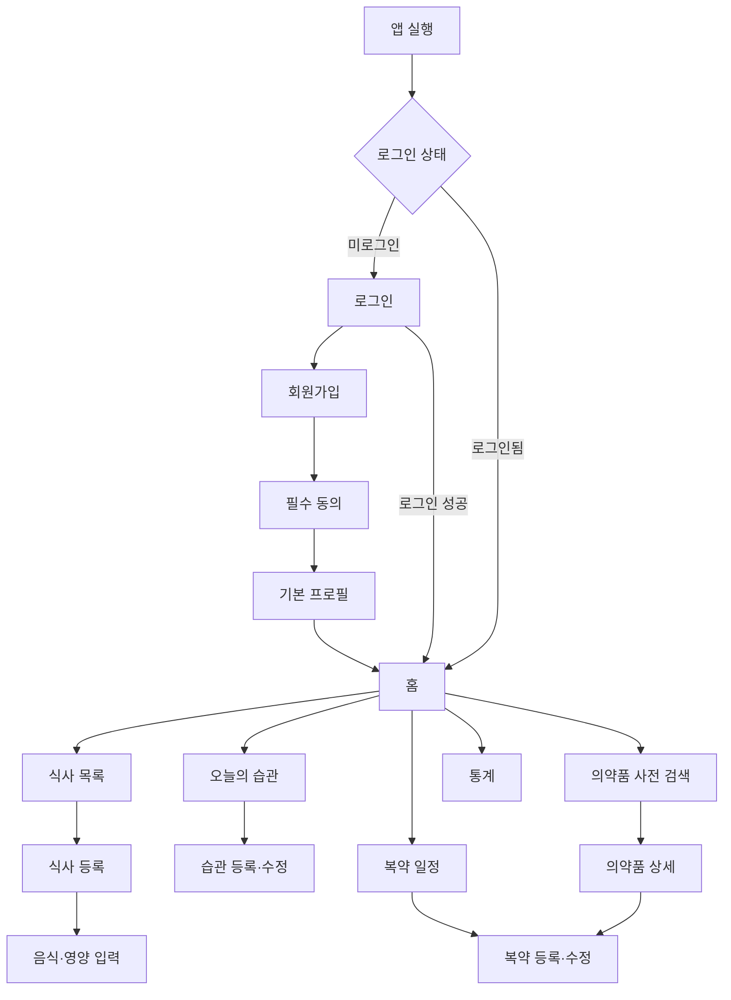

# AI 건강습관 MVP 화면 목록 및 사용자 흐름

작성일: 2026-10-14  
문서 버전: v0.1  
대상 플랫폼: Android / Kotlin / Jetpack Compose  
담당: 현서 작성·구현, 성준 API 검토

## 1. 문서 목적

이 문서는 Android MVP에서 구현할 화면, 화면별 데이터와 사용자 행동, 연결 API 및 이동 흐름을 정의한다. Google AI Studio로 화면을 생성할 때도 이 문서를 기준으로 한 화면씩 구현한다.

## 2. 내비게이션 구조

하단 내비게이션은 핵심 기능을 기준으로 다섯 개 탭을 사용한다.

```text
홈 | 습관 | 식사 | 복약 | 통계
```

의약품 사전은 복약 탭과 홈의 빠른 메뉴에서 진입한다. 설정과 프로필은 홈 상단 또는 마이페이지 진입 버튼으로 제공한다.

## 3. 전체 사용자 흐름



## 4. 화면 ID 규칙

| 접두사 | 영역 |
|---|---|
| `AUTH` | 로그인·회원가입 |
| `ONB` | 초기 설정·동의 |
| `HOME` | 홈 |
| `HAB` | 습관 |
| `MEAL` | 식사 |
| `DRUG` | 의약품 사전 |
| `MED` | 개인 복약 |
| `STAT` | 통계 |
| `SET` | 설정·프로필 |

## 5. 전체 화면 목록

| ID | 화면명 | 우선순위 | 주요 진입 | 주요 API |
|---|---|---:|---|---|
| AUTH-01 | 스플래시·인증 확인 | P0 | 앱 실행 | 토큰 확인 |
| AUTH-02 | 로그인 | P0 | 인증 필요 | 로그인 |
| AUTH-03 | 회원가입 | P0 | 로그인 | 회원가입 |
| ONB-01 | 필수 동의 | P0 | 회원가입 | 동의 저장 |
| ONB-02 | 기본 프로필 | P0 | 필수 동의 | 프로필 저장 |
| HOME-01 | 홈 대시보드 | P0 | 로그인 완료 | 오늘 요약 |
| HAB-01 | 오늘의 습관 | P0 | 하단 탭·홈 | 오늘 회차 목록 |
| HAB-02 | 습관 목록 | P0 | 습관 탭 | 습관 목록 |
| HAB-03 | 습관 등록·수정 | P0 | 습관 목록 | 습관 생성·수정 |
| HAB-04 | 습관 상세·이력 | P1 | 습관 선택 | 습관 상세·기록 |
| MEAL-01 | 식사 목록 | P0 | 하단 탭·홈 | 기간별 식사 목록 |
| MEAL-02 | 식사 등록·수정 | P0 | 식사 목록 | 식사 생성·수정 |
| MEAL-03 | 음식·영양 입력 | P0 | 식사 등록 | 음식 검색·직접 입력 |
| MEAL-04 | 식사 상세 | P0 | 식사 선택 | 식사 상세 |
| DRUG-01 | 의약품 사전 검색 | P0 | 복약·홈 | 의약품 검색 |
| DRUG-02 | 의약품 상세 | P0 | 검색 결과 | 의약품 상세 |
| MED-01 | 오늘의 복약 일정 | P0 | 하단 탭·홈 | 오늘 복약 회차 |
| MED-02 | 개인 복약 목록 | P0 | 복약 탭 | 복약 항목 목록 |
| MED-03 | 복약 등록·수정 | P0 | 사전 상세·목록 | 복약 생성·수정 |
| MED-04 | 복약 상세·기록 | P0 | 복약 항목 | 상세·이력 |
| MED-05 | 실제 복용 입력 | P0 | 오늘 일정 | 복용 행동 저장 |
| STAT-01 | 통계 대시보드 | P0 | 하단 탭 | 기간별 통계 |
| SET-01 | 알림 설정 | P0 | 홈·설정 | 알림 정책 |
| SET-02 | 프로필·계정 | P0 | 홈 | 프로필·로그아웃 |

## 6. 공통 화면 상태

모든 목록·상세 화면은 다음 상태를 명시적으로 구현한다.

```kotlin
sealed interface UiState {
    data object Initial : UiState
    data object Loading : UiState
    data class Success<T>(val data: T) : UiState
    data object Empty : UiState
    data class Error(val message: String, val retryable: Boolean) : UiState
}
```

### 공통 UI 규칙

- API 요청 중에는 중복 제출 버튼을 비활성화한다.
- 빈 목록에는 기능을 시작할 수 있는 버튼을 함께 표시한다.
- 재시도 가능한 오류에는 재시도 버튼을 표시한다.
- 인증 만료는 로그인 화면으로 이동한다.
- 서버 검증 오류는 해당 입력 필드 근처에 표시한다.
- 삭제·중지·건너뛰기는 확인 다이얼로그를 사용한다.
- 의료정보에는 출처와 면책 안내를 표시한다.

## 7. 화면별 상세 정의

### AUTH-01 스플래시·인증 확인

**표시 정보**

- 서비스 로고
- 초기 로딩 표시

**동작**

- 저장된 인증정보 확인
- 유효하면 홈으로 이동
- 없거나 만료되면 로그인으로 이동

**상태**

- 확인 중
- 인증 성공
- 재로그인 필요

### AUTH-02 로그인

**입력**

- 이메일
- 비밀번호

**행동**

- 로그인
- 회원가입 이동
- 비밀번호 표시·숨김

**검증**

- 이메일 형식
- 필수 입력
- 로그인 중 중복 요청 방지

### AUTH-03 회원가입

**입력**

- 이메일
- 비밀번호
- 비밀번호 확인

**행동**

- 이메일 중복 확인
- 계정 생성
- 필수 동의 화면 이동

### ONB-01 필수 동의

**표시 정보**

- 서비스 이용약관
- 개인정보 처리 동의
- 건강정보 처리 동의
- 선택 동의 항목

**행동**

- 전체 선택
- 개별 선택
- 문서 상세 보기
- 필수 동의 완료

### ONB-02 기본 프로필

**입력**

- 닉네임
- 생년월일 선택 입력
- 성별 선택 입력
- 키 선택 입력

몸무게는 고정 프로필 값이 아니라 신체측정 이력으로 관리하는 것을 원칙으로 한다.

### HOME-01 홈 대시보드

**표시 정보**

- 날짜와 사용자명
- 오늘의 습관 완료 개수
- 오늘 식사 기록 요약
- 다음 복약 예정 시각
- 빠른 기록 버튼

**행동**

- 습관 전체 보기
- 식사 추가
- 복약 일정 보기
- 의약품 사전 검색
- 통계 이동

**빈 상태**

- 습관 없음: `첫 습관 만들기`
- 식사 없음: `식사 기록하기`
- 복약 없음: `복약 등록하기`

### HAB-01 오늘의 습관

**표시 정보**

- 예정 시각
- 습관명과 카테고리
- 현재 상태
- 재알림 여부

**행동**

- 완료
- 미루기
- 건너뛰기
- 상세 보기

완료·미루기·건너뛰기 결과는 서버가 반환한 최신 상태를 표시한다.

### HAB-02 습관 목록

**표시 정보**

- 활성 습관
- 중지된 습관
- 반복 요일과 시간 요약

**행동**

- 습관 추가
- 수정
- 중지·재개
- 상세 보기

### HAB-03 습관 등록·수정

**입력**

- 습관명
- 카테고리
- 시작일·종료일
- 반복 요일
- 하루 수행 시각
- 우선순위 선택 입력

**검증**

- 습관명 필수
- 최소 한 개 요일과 시간
- 종료일은 시작일 이후

### HAB-04 습관 상세·이력

**표시 정보**

- 습관 설정
- 최근 완료·미루기·건너뛰기 기록
- 기간별 완료율

### MEAL-01 식사 목록

**표시 정보**

- 날짜별 식사 카드
- 식사 유형과 실제 시각
- 칼로리와 탄·단·지 요약
- 기록 상태

**행동**

- 날짜 변경
- 식사 추가
- 식사 상세

### MEAL-02 식사 등록·수정

**입력**

- 아침·점심·저녁·간식·야식
- 실제 식사 시각
- 음식 목록
- 사진 선택 입력
- 메모 선택 입력

**행동**

- 음식 추가
- 사진 선택·삭제
- 완료 저장
- 건너뜀 저장

### MEAL-03 음식·영양 입력

**입력**

- 음식명
- 섭취량과 단위
- 칼로리
- 탄수화물
- 단백질
- 지방
- 당
- 카페인

**검증**

- 음식명과 섭취량 필수
- 수량과 영양값은 0 이상
- 서버 계산 합계를 최종값으로 사용

### MEAL-04 식사 상세

**표시 정보**

- 식사 유형과 실제 시각
- 사진
- 음식 목록
- 음식별·전체 영양값
- 작성 시각과 수정 여부

**행동**

- 수정
- 삭제 또는 기록 취소

### DRUG-01 의약품 사전 검색

**검색 조건**

- 약 이름
- 성분명
- 업체명

**표시 정보**

- 약 이름
- 업체명
- 제형
- 제공 가능한 대표 이미지

**동작**

- 입력 지연 후 검색
- 페이지 추가 조회
- 최근 검색어 선택 입력
- 검색 결과 선택

오래된 검색 응답이 최신 결과를 덮어쓰지 않도록 이전 요청을 취소하거나 검색 키를 비교한다.

### DRUG-02 의약품 상세

**표시 정보**

- 약 이름과 업체명
- 효능·사용법
- 주의사항·부작용
- 보관법
- 제형·색상·모양·분할선
- 데이터 출처와 갱신일
- 의료정보 면책 안내

**행동**

- 개인 복약으로 등록
- 이전 검색으로 돌아가기

### MED-01 오늘의 복약 일정

**표시 정보**

- 예정 복용 시각
- 약 이름과 회당 복용량
- 식전·식후·공복 관계
- 현재 상태

**행동**

- 복용
- 건너뜀
- 약 없음
- 상세 보기

### MED-02 개인 복약 목록

**표시 정보**

- 복용 중
- 종료·중지
- 약 유형과 기간
- 일정 요약

**행동**

- 의약품 사전 검색
- 직접 복약 등록
- 수정·중지·종료

### MED-03 복약 등록·수정

**입력**

- 처방약·일반의약품·영양제·운동 보충제
- 약 이름 또는 사전 항목
- 복용 목적
- 시작일·종료일
- 반복 요일
- 회차별 시각
- 회당 복용량과 단위
- 식전·식후·공복·시간 지정
- 식사 기준 간격

**검증**

- 약 이름·시작일·복용량 필수
- 복용량은 0보다 큼
- 식전·식후 선택 시 기준 간격 필수

### MED-04 복약 상세·기록

**표시 정보**

- 복약 기본정보
- 현재 일정
- 최근 실제 복용 이력
- 중지·종료 상태

### MED-05 실제 복용 입력

**입력**

- 복용·건너뜀·약 없음
- 실제 복용 시각
- 실제 복용량 선택 입력
- 메모 선택 입력

**규칙**

- 앱 기록 시각은 서버가 별도로 기록한다.
- 예정 시각과 실제 복용 시각의 차이는 서버가 계산한다.

### STAT-01 통계 대시보드

**기간**

- 오늘
- 최근 7일
- 사용자 지정 기간은 P1

**표시 정보**

- 습관 완료율
- 복약 이행률
- 칼로리·탄수화물·단백질·지방·당·카페인 합계

복잡한 시각화보다 숫자, 진행률과 단순 막대그래프를 우선한다.

### SET-01 알림 설정

**입력**

- 알림 활성화
- 재알림 활성화
- 재알림 간격
- 최대 횟수
- 방해금지 시간 선택 입력

앱 권한 상태와 서버 알림 정책을 구분하여 표시한다.

### SET-02 프로필·계정

**표시·행동**

- 닉네임 등 기본 프로필 수정
- 약관·동의 상태 확인
- 로그아웃
- 회원 탈퇴 진입

## 8. 딥링크·알림 이동 규칙

- 습관 알림 선택 → 해당 습관 예정 회차가 보이는 `HAB-01`
- 복약 알림 선택 → 해당 복약 회차가 보이는 `MED-01`
- 이미 처리된 알림 선택 → 최신 상태를 조회한 후 상세 화면 표시
- 로그인 만료 상태에서 알림 선택 → 로그인 후 원래 대상 화면으로 이동
- 존재하지 않거나 권한이 없는 대상 → 홈과 안내 메시지 표시

## 9. 화면 구현 순서

1. 공통 테마·내비게이션·네트워크 상태
2. 로그인·회원가입
3. 의약품 사전 검색·상세
4. 사전에서 개인 복약 등록
5. 오늘의 습관과 습관 등록
6. 식사 등록과 음식·영양 입력
7. 복약 일정과 실제 복용
8. 홈 대시보드
9. 통계와 설정

## 10. 시연 화면 흐름

```text
로그인
→ 홈
→ 의약품 사전 검색
→ 상세 조회
→ 개인 복약 등록
→ 점심 식사 기록
→ 식후 복약 예정 확인
→ 실제 복용 완료
→ 습관 완료
→ 통계 확인
```

## 11. 화면 완료 기준

- [ ] 화면이 Android에서 빌드·실행된다.
- [ ] 실제 API 또는 계약과 동일한 Mock 데이터가 연결된다.
- [ ] 로딩·성공·빈 결과·오류 상태가 구현된다.
- [ ] 입력값과 버튼 중복 처리가 적용된다.
- [ ] 긴 한국어 문구와 작은 화면에서 UI가 깨지지 않는다.
- [ ] 키보드가 입력창과 저장 버튼을 가리지 않는다.
- [ ] 화면 이동과 뒤로 가기가 정상 동작한다.
- [ ] 실제 Android 기기에서 주요 흐름을 확인한다.
- [ ] 비밀정보나 실제 사용자 데이터가 코드·로그에 없다.

